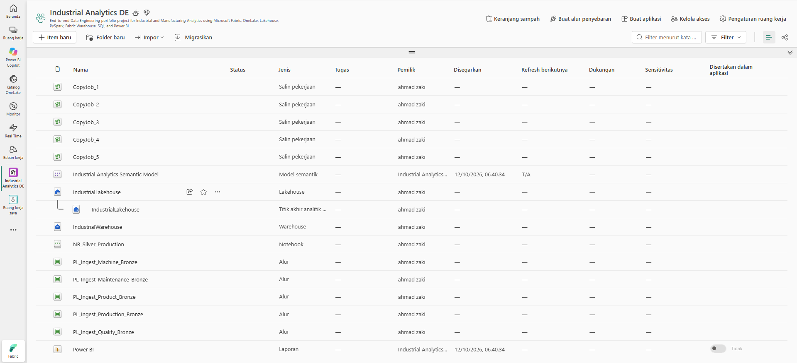
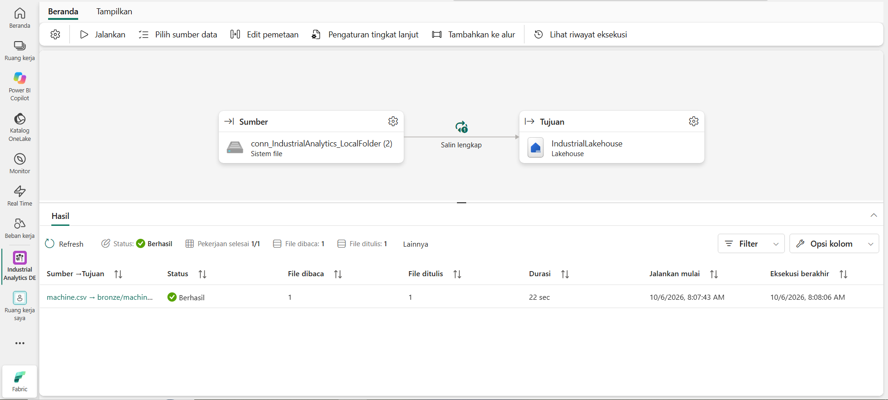
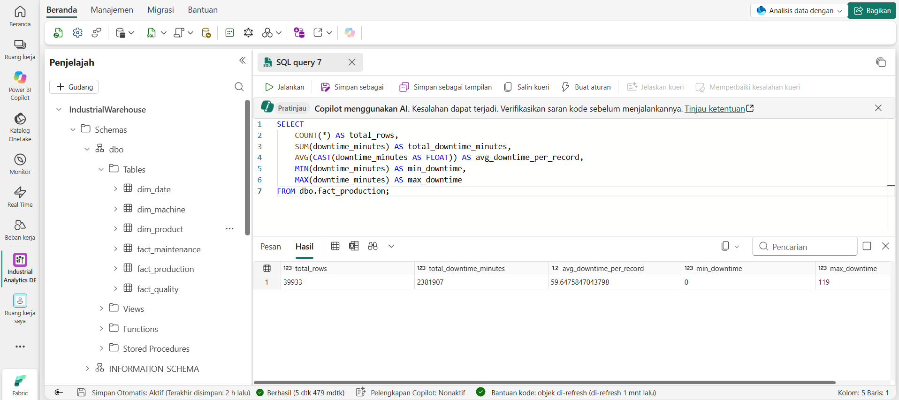
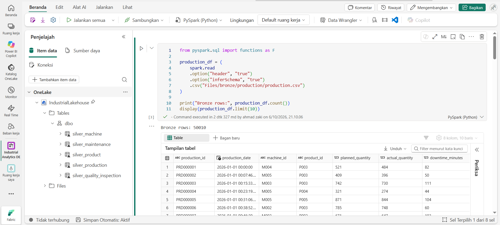
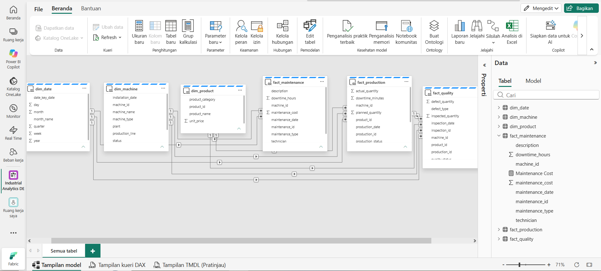
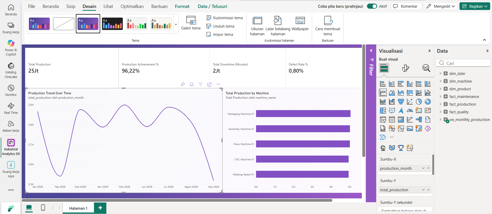

# Industrial Analytics Data Warehouse

An end-to-end Data Engineering portfolio project built with Microsoft Fabric to transform manufacturing data into analytics-ready datasets and business insights.

## Project Overview

This project simulates an industrial data platform for analyzing production performance, machine downtime, maintenance activities, and product quality.

It implements a medallion-style architecture, from raw CSV ingestion to cleaned Delta tables, an analytical warehouse, and a Power BI dashboard.

## Architecture

```text
CSV Sources
    |
    v
Microsoft Fabric Data Pipelines
    |
    v
Bronze Layer - Raw Data
    |
    v
PySpark Transformation
    |
    v
Silver Layer - Cleaned Delta Tables
    |
    v
Gold Layer - Fabric Warehouse
    |
    v
Semantic Model & Power BI Dashboard
```

## Technology Stack

- Microsoft Fabric
- OneLake and Lakehouse
- Fabric Data Pipelines
- PySpark and Delta Lake
- Fabric Warehouse and T-SQL
- Power BI Semantic Model and DAX

## Data Domains

- Machines
- Products
- Production
- Maintenance
- Quality Inspection

## Engineering Features

- Multi-source CSV ingestion
- Data cleaning and deduplication
- Handling of null, invalid, and inconsistent records
- Silver-layer Delta tables
- Dimensional modeling in the Gold layer
- Referential integrity validation
- DAX measures for production and quality KPIs
- Interactive manufacturing analytics dashboard

## Data Warehouse

The Gold layer contains dimension and fact tables for analyzing production, machine maintenance, and quality inspection data.

Key warehouse tables include:

- `dim_date`
- `dim_machine`
- `dim_product`
- `fact_production`
- `fact_maintenance`
- `fact_quality`

## Dashboard KPIs

The Power BI dashboard includes:

- Total Production
- Production Achievement %
- Total Downtime
- Defect Rate %
- Total Production by Machine
- Production Trend Over Time

## Project Documentation

### 1. Microsoft Fabric Workspace



### 2. Bronze Pipeline Execution



### 3. Warehouse SQL Validation



### 4. Silver Transformation with PySpark



### 5. Semantic Model Relationships



### 6. Power BI Dashboard



## Data Validation

SQL validation confirmed that production records match the date dimension, with zero unmatched production dates. Monthly production aggregates were also checked against the detailed production data.

## Data Disclaimer

This project uses synthetic data for learning and portfolio demonstration. It does not represent actual industrial operations.

## Project Status

The core data ingestion pipelines, Silver-layer transformations, Gold-layer warehouse, semantic model, and initial Power BI dashboard have been implemented. Project documentation and portfolio presentation are being finalized.